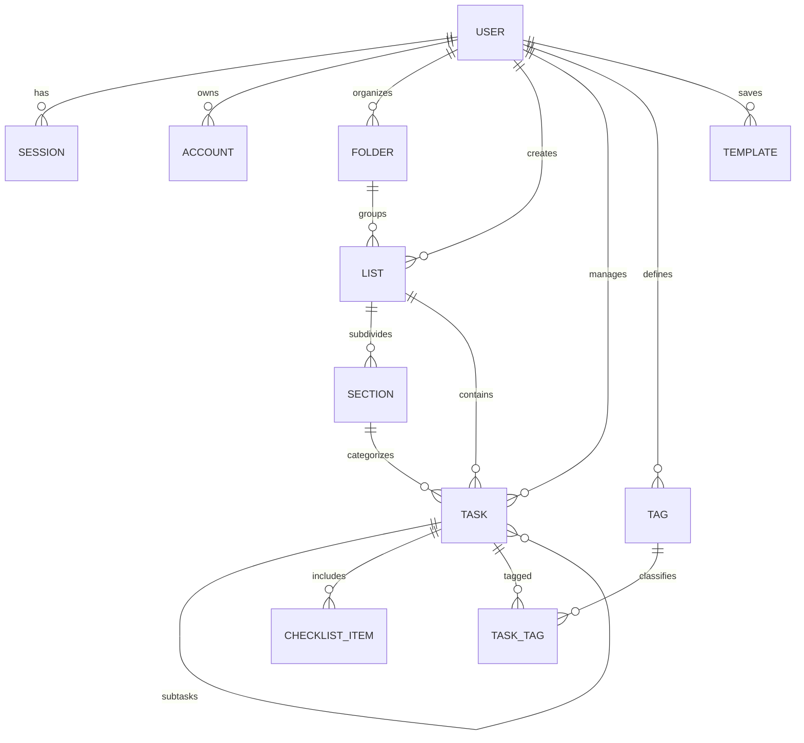

# Todo Studio

> **High-Performance Personal Task & Project Engine**  
> *"Calmness by default, power on demand."*

[](https://bun.sh)
[](https://nextjs.org)
[](https://react.dev)
[](https://tailwindcss.com)
[](https://elysiajs.com)
[](https://better-auth.com)
[](https://orm.drizzle.team)
[](https://www.sqlite.org)

---

## ⚡ Overview & Philosophy

**Todo Studio** is an ultra-fast, calm, and keyboard-centric personal task and project management monorepo designed with a strict standard of engineering excellence. It eliminates bloated enterprise UI patterns in favor of frictionless consumer simplicity inspired by Things 3 and Linear, powered by an end-to-end type-safe TypeScript backend and bleeding-edge React 19 frontend.

### Design Principles:
1. **Calmness by Default**: Zero modal fatigue. Single-line quick add, subtle hairline dividers, tactile color palette, and contextual disclosures that only appear when you need them.
2. **Speed & Zero Friction**: Sub-millisecond local operations, byte-order fractional indexing for $O(1)$ reorders, and cursor-based pagination.
3. **Deep Structural Organization**: Arbitrary hierarchy with Folders $\rightarrow$ Lists $\rightarrow$ Sections $\rightarrow$ Tasks $\rightarrow$ Subtasks (depth 3 recursion with cycle prevention) + Checklists + Tags.
4. **Resilience & Safety**: Transactional bulk operations with atomic rollbacks, recursive soft delete cascades with 1-click restore, and automated 30-day purge crons.

---

## 🏗️ Monorepo Architecture

The workspace is organized as an atomic Bun monorepo housing both high-throughput API services and modern client interfaces:

```
todo/
├── apps/
│   ├── backend/               # ElysiaJS REST API (Port 3001)
│   │   ├── src/
│   │   │   ├── auth.ts        # Better Auth config (Drizzle SQLite, 2FA, bearer tokens)
│   │   │   ├── db/            # Schema, WAL config, auto-migrations
│   │   │   ├── plugins/       # authMacro security middleware
│   │   │   ├── routes/        # Task, Container, Tag, Trash, Template endpoints
│   │   │   ├── utils/         # Fractional indexing, cursor pagination, recursive purge
│   │   │   └── index.ts       # Elysia application, Swagger docs, 03:00 daily cron
│   │   ├── test/              # 82 automated integration & unit tests
│   │   ├── drizzle/           # SQL migration files
│   │   ├── drizzle.config.ts  # Drizzle kit configuration
│   │   └── package.json       # @todo/backend package definition
│   │
│   └── frontend/              # Next.js 16.4.5 + React 19 App Router (Port 3000)
│       ├── src/
│       │   ├── app/           # App Router pages, layout, and Tailwind v4 theme
│       │   ├── components/    # Atomic UI components, modals, and task views
│       │   │   ├── app/       # Workspace, Sidebar, TaskPane, QuickAdd, DetailPanel
│       │   │   ├── auth/      # AuthModal, ProfileModal, UserNav, AuthSessionCard
│       │   │   ├── landing/   # Hero, FeaturesGrid, LiveDemoPreview, FAQSection
│       │   │   └── ui/        # Accessible Button, Input, Card, Badge, Skeleton
│       │   ├── hooks/         # Custom hooks (invite validator, shortcuts)
│       │   └── lib/           # Type-safe API client, adapters, and Better Auth client
│       ├── test/              # 43 automated integration & component tests
│       └── package.json       # @todo/frontend package definition
│
├── package.json               # Root monorepo workspace configuration
├── tsconfig.json              # Monorepo base TypeScript settings
└── bun.lock                   # Deterministic lockfile
```

### Application Breakdown

| Application | Technology Stack | Port | Description |
| :--- | :--- | :--- | :--- |
| **`@todo/backend`** | ElysiaJS, Better Auth, Drizzle ORM, `bun:sqlite` | `3001` | High-throughput, low-latency REST API with fractional ordering, transactional bulk mutations, OpenAPI 3 / Swagger documentation, and automated daily cleanup jobs. |
| **`@todo/frontend`** | Next.js 16.4.5, React 19.3.0, Tailwind CSS v4, Lucide | `3000` | Keyboard-driven web application featuring a tactile Deep Blue (`#051A4D`) & Bubblegum Pink (`#FD91CC`) design system, Things 3-style Quick Add, and instant client state sync. |


---

## 🚀 Getting Started & Local Development

### Prerequisites

- **[Bun](https://bun.sh/)** version `>= 1.3` (runtime, package manager, and test runner)
- **Node.js** `>= 20.0` (optional, for Next.js tooling compatibility)

### 1. Clone & Install

```bash
git clone https://github.com/faizan1250/todo.git
cd todo
bun install
```

### 2. Environment Setup

Default values work out of the box for local development without any required configuration. For custom environments, you can define the following environment variables:

#### Backend (`apps/backend/.env`)
```env
PORT=3001
DB_FILE=sqlite.db
BETTER_AUTH_URL=http://localhost:3001
BETTER_AUTH_SECRET=dev-secret-key-change-in-production-todo-app
FRONTEND_URL=http://localhost:3000
```

#### Frontend (`apps/frontend/.env.local`)
```env
NEXT_PUBLIC_API_URL=http://localhost:3001
```

### 3. Running the Development Servers

Start backend and frontend concurrently or independently using the monorepo root scripts:

```bash
# Terminal 1: Launch the ElysiaJS backend with hot reload (Port 3001)
bun run dev:backend

# Terminal 2: Launch the Next.js frontend with Turbopack (Port 3000)
bun run dev:frontend
```

Once running:
- **Web App**: Open [http://localhost:3000](http://localhost:3000) to view the Todo Studio interface.
- **Backend API**: Accessible at [http://localhost:3001](http://localhost:3001).
- **Interactive Swagger Docs**: Open [http://localhost:3001/swagger](http://localhost:3001/swagger) for the interactive OpenAPI explorer.

---

## 🛠️ Workspace Scripts & Tooling

The root `package.json` coordinates all monorepo workspaces using `bun --filter`:

| Command | Target | Purpose |
| :--- | :--- | :--- |
| `bun run dev:backend` | `@todo/backend` | Runs Elysia API with `--watch` on `http://localhost:3001` |
| `bun run dev:frontend` | `@todo/frontend` | Starts Next.js 16 with Turbopack on `http://localhost:3000` |
| `bun run build` | All packages | Compiles backend and generates production Next.js build |
| `bun run build:frontend`| `@todo/frontend` | Production build of Next.js frontend |
| `bun test` | All packages | Executes complete automated test suite (125+ tests) |
| `bun run typecheck` | All packages | Strict TypeScript validation across all workspaces (`tsc --noEmit`) |
| `bun run lint` | All packages | Runs ESLint 9 checks across frontend codebase |

### Test Suite Breakdown

Todo Studio maintains 100% green automated test coverage with **125+ passing tests** across both backend and frontend:

- **Backend (`82 passing tests`)**:
  - `test/auth.test.ts`: Email/password authentication, TOTP two-factor enrollment, session validation, and `/me` profile updates.
  - `test/health.test.ts`: Healthcheck, CORS headers, and preflight OPTIONS verification.
  - `test/containers.test.ts`: Folders, Lists, Sections CRUD, position ordering, and default Inbox lifecycle.
  - `test/tasks.test.ts`: Full task CRUD, keyset cursor pagination on `(position, id)`, and 3-query batch includes.
  - `test/subtasks.test.ts`: Subtask hierarchy, max depth 3 enforcement, and cycle prevention.
  - `test/templates.test.ts`: Snapshotting task trees, deep template copy, and template instantiation.
  - `test/trash.test.ts`: Recursive soft-delete cascading, 1-click restore with Inbox fallback, and purge cron.
  - `test/bulk.test.ts`: Transactional multi-task operations (`move`, `tag`, `untag`, `complete`, `reopen`, `archive`, `delete`, `set_priority`) with 404 atomic rollback.
- **Frontend (`43 passing tests`)**:
  - `test/auth-integration.test.ts`: API client authentication flows, token handling, and profile persistence.
  - `test/polish-and-sync.test.ts`: Accessible skeleton loaders, optimistic UI updates, and profile syncing.
  - `test/components.test.ts`: Task row interaction, status toggling, and dialog operations.

---

## ✨ Key Features & Architectural Capabilities

Todo Studio combines consumer-grade responsiveness with enterprise-grade data guarantees. Every layer of the stack is optimized for predictability, latency, and correctness.

### 1. Hierarchical Domain & Structural Organization
- **Multi-Level Containers**: Organize projects hierarchically into **Folders** $\rightarrow$ **Lists** $\rightarrow$ **Sections** $\rightarrow$ **Tasks**.
- **Deep Subtask Trees**: Tasks support recursive subtasks up to a maximum depth of 3 (`Parent -> Subtask -> Sub-subtask`) with automated cycle detection preventing circular task relationships.
- **Micro-Steps via Checklists**: Every task and subtask supports an ordered, toggleable checklist for atomic verification without task bloat.
- **Orthogonal Tag Taxonomy**: Global and list-scoped tags allow multi-dimensional filtering, searching, and batch categorization across disparate projects.
- **Automated Default Inbox**: User registration automatically provisions a reserved `Inbox` container that serves as the root destination for rapid capture and trash-restored orphan items.

### 2. Byte-Order Fractional Indexing ($O(1)$ Reorders)
- Implements byte-order lexicographical fractional indexing via `fractional-indexing`.
- Moving any item between two arbitrary siblings computes a mid-key string in constant $O(1)$ time without updating adjacent records or requiring sequential index re-writes.
- Eliminates locking contention and cascade updates across large lists, guaranteeing zero-downtime, conflict-free drag-and-drop reordering.

### 3. Keyset Cursor Pagination & Zero $N+1$ Batch Loader
- **Stable Keyset Pagination**: Queries paginate deterministically using composite cursor tuples `(position, id)`. Eliminates offset drift, phantom rows, and $O(N)$ scanning performance penalties on large datasets.
- **Parallel 3-Query Batch Loader**: When passing `include=subtasks,checklist,tags`, the backend dispatches 3 indexed queries executed in parallel via SQLite WAL connections, mapping results in-memory with $O(1)$ hash maps. Eliminates the $N+1$ query problem entirely.

### 4. Transactional Bulk Operations with Strict Rollback
- Perform batch operations (`move`, `tag`, `untag`, `complete`, `reopen`, `archive`, `delete`, `set_priority`, `set_due_date`) over dozens of tasks in a single atomic database transaction.
- **Strict 404 Rollback Guarantee**: If any target task ID does not exist, belongs to another user, or fails validation, the entire transaction rolls back immediately with zero partial state mutation.

### 5. Resilient Soft-Delete Cascade, 1-Click Restore & Daily Purge
- **Recursive Soft-Delete**: Deleting a folder, list, section, or task cascades `deletedAt` timestamps across all dependent child items, checklists, and tag relations.
- **Smart 1-Click Restore**: Restoring an item intelligently checks for ancestor viability. If the original container was permanently removed, the restored task automatically falls back safely to the user's default `Inbox`.
- **Automated Purge Cron**: Powered by `@elysiajs/cron`, an internal daemon runs daily at `03:00 UTC` to clean up and permanently purge soft-deleted records older than 30 days.

### 6. Deep Tree Duplication & Reusable Template Engine
- **Task Tree Snapshots**: Snapshot any complex task and its nested hierarchy (subtasks, checklist items, tags) into a reusable template definition (capped at 100 nodes, depth $\le 3$).
- **One-Click Instantiation**: Instantiate templates into any list or section with newly minted UUIDv7 identifiers and preserved relative tree topologies.
- **Deep Duplication**: Clone existing task trees instantaneously with automated ID re-mapping and position-right-after insertion.

### 7. Dual-Mode Authentication & Multi-Tenant Security
- **Instant Demo Experience**: Explore the full platform without barriers via an ephemeral guest demo session.
- **Production Better Auth**: Multi-tenant authentication with Argon2/scrypt password hashing, session tokens, TOTP two-factor authentication (2FA) with recovery backup codes, and strict user-scoped tenancy isolation on every database query.

---

## 🗄️ Database Architecture & Data Modeling

Todo Studio leverages `bun:sqlite` paired with Drizzle ORM to combine raw native C-level SQLite query execution speeds with fully type-safe schema definitions and migration safety.

### SQLite WAL Mode & Concurrency Guarantees

The database connection initializes with high-performance production PRAGMAs:

```typescript
db.run(sql`PRAGMA journal_mode = WAL;`);
db.run(sql`PRAGMA foreign_keys = ON;`);
db.run(sql`PRAGMA synchronous = NORMAL;`);
db.run(sql`PRAGMA busy_timeout = 5000;`);
```

- **Write-Ahead Logging (WAL)**: Reads and writes never block each other. Background readers query snapshot views concurrently while transactional mutations proceed in the WAL file.
- **Foreign Key Enforcement**: Cascading deletes and nullifications run natively within the SQLite engine, preventing orphaned rows.
- **Normal Synchronous**: Balanced durability and high-throughput write performance.
- **5000ms Busy Timeout**: Prevents instantaneous lock contention under heavy local or background cron tasks.

### Entity Relationship Model

The core relational topology centers around user-scoped organizational hierarchies, recursive task structures, and orthogonal tagging:



### Core Schema Tables Reference

All synchronized entities inherit shared base metadata:
- `id`: Monotonically incrementing UUIDv7 generated via `Bun.randomUUIDv7()` for time-ordered index clustering.
- `createdAt` / `updatedAt`: Millisecond timestamp precision (`mode: "timestamp_ms"`).
- `version`: Integer sequence incremented on mutations for optimistic concurrency control.
- `deletedAt`: Soft-delete timestamp for trash workflows and 30-day purge cascades.

| Table Name | Description | Key Relationships & Constraints |
| :--- | :--- | :--- |
| **`user`** | User profile, authentication state, locale, and JSON preferences | `id` (PK), `email` (Unique), `two_factor_enabled` |
| **`session`** | Active authentication sessions with expiration timestamps | `user_id` $\rightarrow$ `user.id` (Cascade delete), Indexed on `user_id` |
| **`account`** | Credential provider records and hashed passwords | `user_id` $\rightarrow$ `user.id` (Cascade delete), Indexed on `user_id` |
| **`folders`** | High-level organizational buckets grouping multiple lists | `user_id` $\rightarrow$ `user.id`, Composite index `(user_id, position)` |
| **`lists`** | Task containers (projects, areas) supporting default Inbox | `folder_id` $\rightarrow$ `folders.id` (Set Null), `is_inbox` boolean flag |
| **`sections`** | Workflow columns or section dividers within a list | `list_id` $\rightarrow$ `lists.id` (Cascade delete), Indexed on `(list_id, position)` |
| **`tasks`** | Core task entities supporting scheduling, notes, and priority | `list_id`, `section_id`, recursive `parent_id` $\rightarrow$ `tasks.id` (Cascade) |
| **`checklist_items`** | Fine-grained checkable sub-items within a parent task | `task_id` $\rightarrow$ `tasks.id` (Cascade delete), Indexed on `(task_id, position)` |
| **`tags`** | Taxonomy labels with custom colors | Case-insensitive unique index on `(user_id, name)` where active |
| **`task_tags`** | Many-to-many junction joining tasks and tags | Composite PK `(task_id, tag_id)`, Foreign keys cascade on delete |
| **`templates`** | Reusable task tree JSON snapshots (up to 100 nodes, depth 3) | `user_id` $\rightarrow$ `user.id`, Indexed on `user_id` |
| **`recurrences`** | RFC 5545 recurrence rules for periodic tasks | `user_id` $\rightarrow$ `user.id`, mode: `fixed` or `after_completion` |

---

## 📡 API Reference & OpenAPI Specification

The backend exposes a strictly typed, OpenAPI 3.0-compliant REST API built with ElysiaJS. 

### Interactive OpenAPI Explorer

Todo Studio provides an embedded Swagger UI for interactive exploration, schema verification, and direct testing:

- **Swagger UI**: [http://localhost:3001/swagger](http://localhost:3001/swagger)
- **JSON Specification**: `http://localhost:3001/swagger/json`

### Authentication & User Management

| Method | Endpoint | Description | Auth Required |
| :--- | :--- | :--- | :---: |
| `POST` | `/api/auth/sign-up/email` | Create new account with email and password | No |
| `POST` | `/api/auth/sign-in/email` | Authenticate with credentials and receive bearer token | No |
| `POST` | `/api/auth/sign-out` | Invalidate current bearer token session | Yes |
| `GET` | `/api/auth/session` | Retrieve active session details and user object | Yes |
| `POST` | `/api/auth/two-factor/*` | Manage TOTP 2FA (enable, generate QR, verify, disable) | Yes |
| `GET` | `/api/v1/me` | Fetch user profile, timezones, and JSON preferences | Yes |
| `PATCH` | `/api/v1/me` | Update name, timezone, week start day, or preferences | Yes |

### Containers: Folders, Lists & Sections

| Method | Endpoint | Description |
| :--- | :--- | :--- |
| `GET` | `/api/v1/folders` | List all non-deleted folders ordered by fractional position |
| `POST` | `/api/v1/folders` | Create a new folder (`name`, `color`, `icon`, `position`) |
| `PATCH` | `/api/v1/folders/:id` | Update folder properties |
| `DELETE` | `/api/v1/folders/:id` | Soft-delete folder (nullifies child list folder references) |
| `POST` | `/api/v1/folders/:id/move` | Update folder position relative to siblings |
| `GET` | `/api/v1/lists` | List all active lists (including Inbox and archived flags) |
| `POST` | `/api/v1/lists` | Create a list inside an optional folder (`name`, `color`, `icon`, `viewType`) |
| `PATCH` | `/api/v1/lists/:id` | Update list metadata or move to another folder |
| `DELETE` | `/api/v1/lists/:id` | Soft-delete list and cascade deletion to sections and tasks |
| `POST` | `/api/v1/lists/:id/move` | Reposition list using fractional index math |
| `POST` | `/api/v1/lists/:id/archive` | Archive list and suppress from active navigation |
| `POST` | `/api/v1/lists/:id/unarchive` | Unarchive list back to active status |
| `GET` | `/api/v1/lists/:listId/sections` | Fetch sections belonging to a list ordered by position |
| `POST` | `/api/v1/lists/:listId/sections` | Create a new section within a list |
| `PATCH` | `/api/v1/sections/:id` | Rename or modify section attributes |
| `DELETE` | `/api/v1/sections/:id` | Soft-delete section (nullifies task section references) |
| `POST` | `/api/v1/sections/:id/move` | Reposition section within the list |

### Tasks & Subtask Operations

| Method | Endpoint | Description |
| :--- | :--- | :--- |
| `GET` | `/api/v1/tasks` | Keyset cursor-paginated tasks (`limit`, `cursor`, `listId`, `include=subtasks,checklist,tags`) |
| `POST` | `/api/v1/tasks` | Create task (`title`, `notes`, `priority`, `dueAt`, `listId`, `sectionId`, `parentId`) |
| `GET` | `/api/v1/tasks/:id` | Retrieve single task with optional nested relation includes |
| `PATCH` | `/api/v1/tasks/:id` | Update title, notes, status, priority, dates, or container assignment |
| `DELETE` | `/api/v1/tasks/:id` | Soft-delete task and recursively cascade down subtasks |
| `POST` | `/api/v1/tasks/:id/move` | Move task to a new list, section, or position |
| `POST` | `/api/v1/tasks/:id/complete` | Mark task done with optional recursive subtask completion |
| `POST` | `/api/v1/tasks/:id/reopen` | Reopen a completed task without altering descendant statuses |
| `POST` | `/api/v1/tasks/:id/archive` | Archive task and its active descendants |
| `POST` | `/api/v1/tasks/:id/unarchive` | Unarchive task and matching timestamped descendants |
| `POST` | `/api/v1/tasks/:id/duplicate` | Deep clone task tree (subtasks, checklists, tags) with new IDs |
| `POST` | `/api/v1/tasks/:id/save-as-template` | Snapshot task hierarchy into a reusable JSON template |
| `POST` | `/api/v1/tasks/bulk` | Atomic batch execution (`move`, `tag`, `untag`, `complete`, `delete`, etc.) |

### Checklists & Tags

| Method | Endpoint | Description |
| :--- | :--- | :--- |
| `GET` | `/api/v1/tasks/:taskId/checklist` | List all checklist items belonging to a task |
| `POST` | `/api/v1/tasks/:taskId/checklist` | Append a new checklist item to a task |
| `PATCH` | `/api/v1/checklist/:id` | Toggle done status or update text |
| `DELETE` | `/api/v1/checklist/:id` | Remove a checklist item |
| `POST` | `/api/v1/checklist/:id/move` | Reorder checklist item position |
| `GET` | `/api/v1/tags` | List all user tags |
| `POST` | `/api/v1/tags` | Create a new tag (`name`, `color`) |
| `PATCH` | `/api/v1/tags/:id` | Rename tag or update color badge |
| `DELETE` | `/api/v1/tags/:id` | Soft-delete tag and disassociate from tasks |
| `PUT` | `/api/v1/tasks/:id/tags` | Atomically replace all tags assigned to a task |

### Templates, Trash & System

| Method | Endpoint | Description |
| :--- | :--- | :--- |
| `GET` | `/api/v1/templates` | List all saved task tree templates |
| `POST` | `/api/v1/templates` | Create a new template definition from JSON payload |
| `GET` | `/api/v1/templates/:id` | Retrieve template payload and structural schema |
| `PATCH` | `/api/v1/templates/:id` | Rename template or modify structure |
| `DELETE` | `/api/v1/templates/:id` | Delete saved template |
| `POST` | `/api/v1/templates/:id/instantiate` | Instantiate template into target list/section with new UUIDs |
| `GET` | `/api/v1/trash` | List soft-deleted folders, lists, sections, and tasks |
| `POST` | `/api/v1/trash/restore` | Restore soft-deleted item (auto-repairs to Inbox if parent removed) |
| `DELETE` | `/api/v1/trash/purge` | Permanently purge a specific soft-deleted record |
| `DELETE` | `/api/v1/trash` | Permanently purge all soft-deleted items currently in trash |
| `GET` | `/health` | Unauthenticated uptime health check with server timestamp |

---

## 🎨 Design System & Frontend Architecture

Todo Studio features a bespoke, tactile user interface crafted with **Next.js 16.4.5 App Router**, **React 19.3.0**, and **Tailwind CSS v4**. It rejects generic, monotone corporate dashboards in favor of an ergonomic, high-contrast aesthetic calibrated for sustained focus and visual delight.

### Visual Palette & Tactile Tokens

The color system anchors around contrasting deep maritime hues and vibrant tactile accents:

| Token | Hex Value | Role & Semantic Purpose |
| :--- | :--- | :--- |
| **Deep Blue** | `#051A4D` | Primary brand anchor, header accents, and high-contrast dark surface backgrounds |
| **Navy Surface** | `#082363` | Elevated cards, dark mode modal containers, and floating panels |
| **Midnight Trench** | `#061B4A` | Nested list backgrounds, dark mode dividers, and recessed input fields |
| **Bubblegum Pink** | `#FD91CC` | High-energy focal accents, interactive sparks, toggle states, and key highlights |
| **Soft Flamingo** | `#FFA8D7` | Hover states, keyboard keycap text, and subtle focus halos |
| **Canvas Light** | `#F2F5FC` | Soft off-white neutral canvas background reducing eye fatigue |
| **Hairline Border** | `#E4E8F2` | Ultra-subtle border strokes maintaining crisp structure without visual clutter |
| **Ink Navy** | `#0B1220` | High-legibility deep typography for effortless scanning |

### Component Architecture & State Management

The frontend codebase is organized into modular layers balancing fast rendering with zero state tearing:

```
apps/frontend/src/
├── app/                       # Next.js 16 App Router pages, global metadata, font loader
│   ├── layout.tsx             # Root HTML shell, theme script, and font declarations
│   ├── page.tsx               # Unauthenticated landing page & live interactive demo
│   └── globals.css            # Tailwind CSS v4 directives and CSS variable definitions
├── components/
│   ├── app/                   # Core application interface components
│   │   ├── command-palette.tsx    # Global Cmd+K fuzzy action and navigation modal
│   │   ├── task-pane.tsx          # Virtualized task row list, sections, and inline quick-add
│   │   ├── task-detail-panel.tsx  # Slide-over inspector (notes, due dates, subtasks, checklists)
│   │   ├── bulk-action-toolbar.tsx# Floating contextual toolbar for multi-selected tasks
│   │   ├── sidebar.tsx            # Collapsible navigation tree (Folders, Lists, Inbox, Trash)
│   │   ├── trash-modal.tsx        # Trash bin browser with 1-click restore and purge
│   │   ├── templates-modal.tsx    # Reusable task hierarchy template manager
│   │   └── keyboard-shortcuts-modal.tsx # Interactive keyboard shortcuts cheat sheet
│   ├── auth/                  # Authentication & session controls
│   │   ├── auth-modal.tsx         # Tabbed Sign-In, Sign-Up, and 2FA verification dialog
│   │   ├── auth-provider.tsx      # React Context managing session tokens and user state
│   │   └── profile-modal.tsx      # User settings, preferences, and session management
│   └── ui/                    # Primitive accessible UI elements
│       ├── button.tsx, badge.tsx, card.tsx, input.tsx, skeleton.tsx
├── hooks/                     # Custom hooks (shortcuts, focus traps, invite validation)
└── lib/                       # Type-safe API client, adapters, and Better Auth client
```

#### React 19 Paradigms:
- **Zero Cascading Effects**: Eliminates problematic `useEffect` dependency chains. State transformations use derived values computed during render.
- **Optimistic UI Mutations**: Toggling a task checkbox or checklist item applies immediate visual feedback, asynchronously syncing with the backend and gracefully rolling back on unexpected network failure.
- **Accessible Focus Management**: Built-in ARIA attributes, focus trap cycling, and clean event-listener teardowns across all modals and slide-out drawers.

---

## ⌨️ Keyboard Shortcuts Reference

Todo Studio is engineered to be operated entirely without a mouse. Master your workspace with low-latency keyboard shortcuts available across all views:

### Navigation Shortcuts

| Shortcut | Action | Description | Scope |
| :---: | :--- | :--- | :--- |
| <kbd>J</kbd> or <kbd>↓</kbd> | Next Task | Move cursor focus to the next task in the active list | Task List |
| <kbd>K</kbd> or <kbd>↑</kbd> | Previous Task | Move cursor focus to the previous task in the active list | Task List |
| <kbd>⌘K</kbd> or <kbd>Ctrl + K</kbd> | Command Palette | Open fuzzy command palette to jump between lists or actions | Global |
| <kbd>/</kbd> | Quick Search | Direct shortcut into the Command Palette search filter | Global |
| <kbd>Esc</kbd> | Dismiss / Close | Close open modals, drawers, command palette, or clear selection | Global |

### Task Action Shortcuts

| Shortcut | Action | Description | Scope |
| :---: | :--- | :--- | :--- |
| <kbd>N</kbd> | Quick Add Task | Instantly focus the task creation input in the active list | Task List |
| <kbd>Space</kbd> or <kbd>X</kbd> | Toggle Complete | Mark the focused task complete or reopen it | Task List |
| <kbd>Enter</kbd> | Inspect Task | Open the task detail slide-over panel for rich editing | Task List |
| <kbd>D</kbd> or <kbd>⌫</kbd> | Delete Task | Soft-delete selected task to trash with an instant undo toast | Task List |

### General & System Shortcuts

| Shortcut | Action | Description | Scope |
| :---: | :--- | :--- | :--- |
| <kbd>?</kbd> or <kbd>Shift + /</kbd> | Cheat Sheet | Open the interactive keyboard shortcuts overlay modal | Global |
| <kbd>Esc</kbd> | Dismiss Panel | Close any open modal dialog or slide-out drawer safely | Global |

---

## 🚢 Production Deployment & Security Checklist

Todo Studio is designed for straightforward deployment on single-node VPS environments, bare metal, or containerized orchestrators.

### Production Build & Launch

Execute production builds across all workspaces:

```bash
# 1. Install production dependencies
bun install --frozen-lockfile --production

# 2. Compile Next.js frontend and backend artifacts
bun run build

# 3. Start Backend API in production mode (Port 3001)
NODE_ENV=production bun run apps/backend/src/index.ts

# 4. Start Next.js Frontend Server (Port 3000)
bun --filter @todo/frontend start
```

### Production Environment Variables

Ensure all sensitive production secrets are securely configured:

| Variable | Target | Requirement & Guidance |
| :--- | :--- | :--- |
| `NODE_ENV` | Backend & Frontend | Set to `production` |
| `PORT` | Backend | Port number for the Elysia API server (default: `3001`) |
| `DB_FILE` | Backend | Path to persistent SQLite database (e.g. `/var/lib/todo/prod.db`) |
| `BETTER_AUTH_SECRET` | Backend | Cryptographically random secret key (minimum 32 characters) |
| `BETTER_AUTH_URL` | Backend | Canonical backend URL (e.g. `https://api.todo.studio`) |
| `FRONTEND_URL` | Backend | Canonical frontend URL for CORS validation (e.g. `https://todo.studio`) |
| `NEXT_PUBLIC_API_URL` | Frontend | Public API endpoint reachable by clients (e.g. `https://api.todo.studio`) |

### Production Security Checklist

- [x] **Zero Plaintext Secrets**: Passwords securely hashed with multi-pass cryptographic functions via Better Auth.
- [x] **Strict CORS Policy**: Restricted cross-origin resource sharing validating trusted frontend domains with preflight handling.
- [x] **SQL Injection Immunity**: Parameterized query generation enforced exclusively via Drizzle ORM.
- [x] **Two-Factor Authentication**: Native TOTP 2FA support with encrypted server-side secrets and single-use emergency backup codes.
- [x] **Bounded Result Windows**: Hard caps on keyset pagination queries (`limit <= 100`) preventing memory exhaustion attacks.
- [x] **WAL Persistence & Backups**: Daily hot backups using SQLite `VACUUM INTO '/backups/backup-${Date.now()}.db'` or continuous replication tools like Litestream.
- [x] **Automated Data Purge**: Background cron job cleaning soft-deleted trash items older than 30 days every day at 03:00 UTC.

---

## 🤝 Contributing & Code Quality Standards

Contributions to Todo Studio are welcome. To maintain our standard of engineering excellence, all contributions must adhere to the following workflow:

### Development Workflow

1. **Fork & Branch**: Create a focused branch off `main` using descriptive conventional prefixes:
   - `feat/feature-name` for new user-facing functionality
   - `fix/bug-description` for bug fixes and patches
   - `refactor/subsystem-name` for structural code refactoring
   - `docs/topic-name` for documentation improvements
2. **Deterministic Automated Tests**: Every new feature or bug fix must include deterministic unit or integration tests in `apps/backend/test/` or `apps/frontend/test/`.
3. **Verify All Checks**: Before submitting a pull request, ensure all test suites and static checks pass:
   ```bash
   bun test          # All 125+ tests must pass with 100% green status
   bun run typecheck # Strict TypeScript check across all packages
   bun run lint      # ESLint 9 styling and syntax validation
   ```
4. **Conventional Commits**: Write clear, imperative commit messages conforming to the Conventional Commits specification:
   ```
   feat(backend): add keyset cursor pagination on task tags
   fix(frontend): prevent focus loss on quick-add escape keypress
   docs(readme): add production security checklist
   ```

---

## 📄 License

This project is open-source software licensed under the **[MIT License](https://opensource.org/licenses/MIT)**.

```
MIT License

Copyright (c) 2026 Todo Studio Contributors

Permission is hereby granted, free of charge, to any person obtaining a copy
of this software and associated documentation files (the "Software"), to deal
in the Software without restriction, including without limitation the rights
to use, copy, modify, merge, publish, distribute, sublicense, and/or sell
copies of the Software, and to permit persons to whom the Software is
furnished to do so, subject to the following conditions:

The above copyright notice and this permission notice shall be included in all
copies or substantial portions of the Software.

THE SOFTWARE IS PROVIDED "AS IS", WITHOUT WARRANTY OF ANY KIND, EXPRESS OR
IMPLIED, INCLUDING BUT NOT LIMITED TO THE WARRANTIES OF MERCHANTABILITY,
FITNESS FOR A PARTICULAR PURPOSE AND NONINFRINGEMENT. IN NO EVENT SHALL THE
AUTHORS OR COPYRIGHT HOLDERS BE LIABLE FOR ANY CLAIM, DAMAGES OR OTHER
LIABILITY, WHETHER IN AN ACTION OF CONTRACT, TORT OR OTHERWISE, ARISING FROM,
OUT OF OR IN CONNECTION WITH THE SOFTWARE OR THE USE OR OTHER DEALINGS IN THE
SOFTWARE.
```
